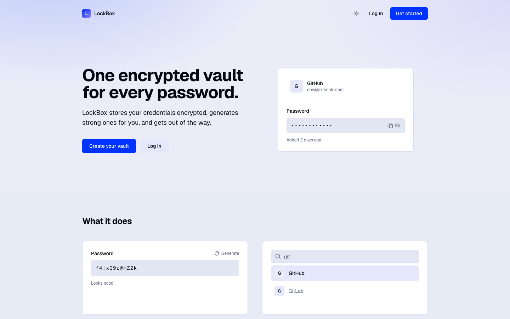
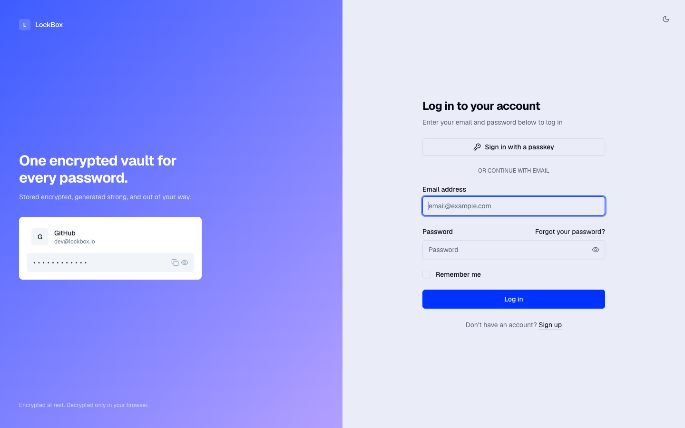
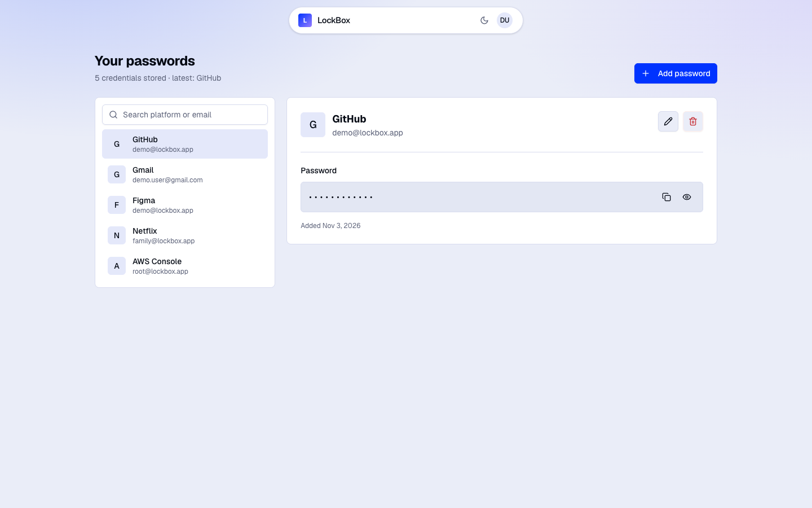
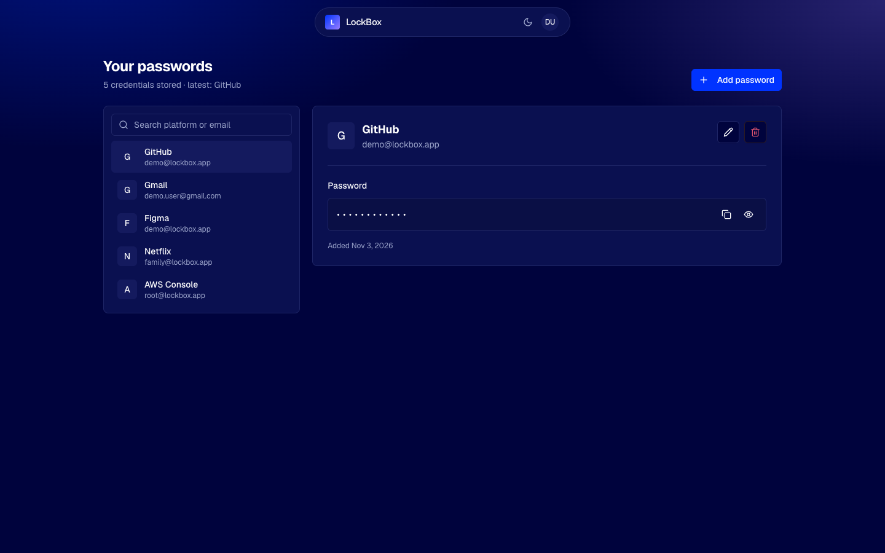
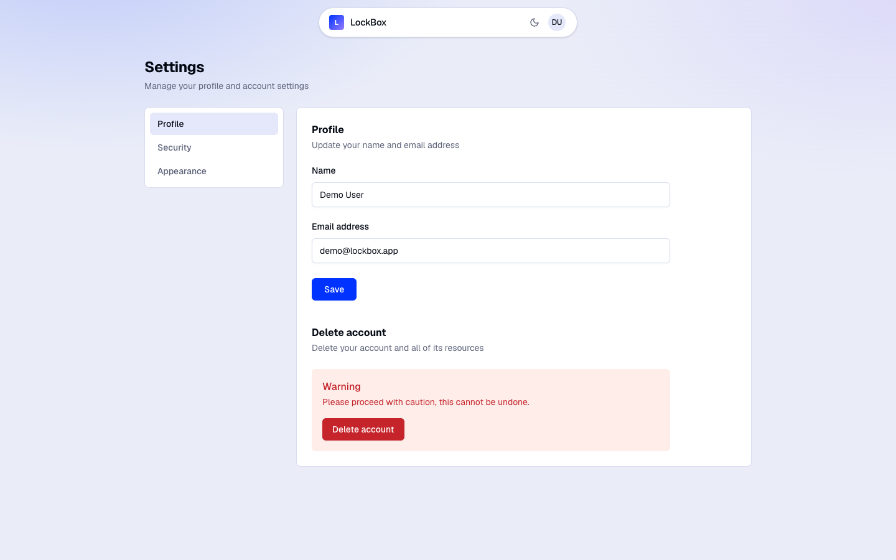
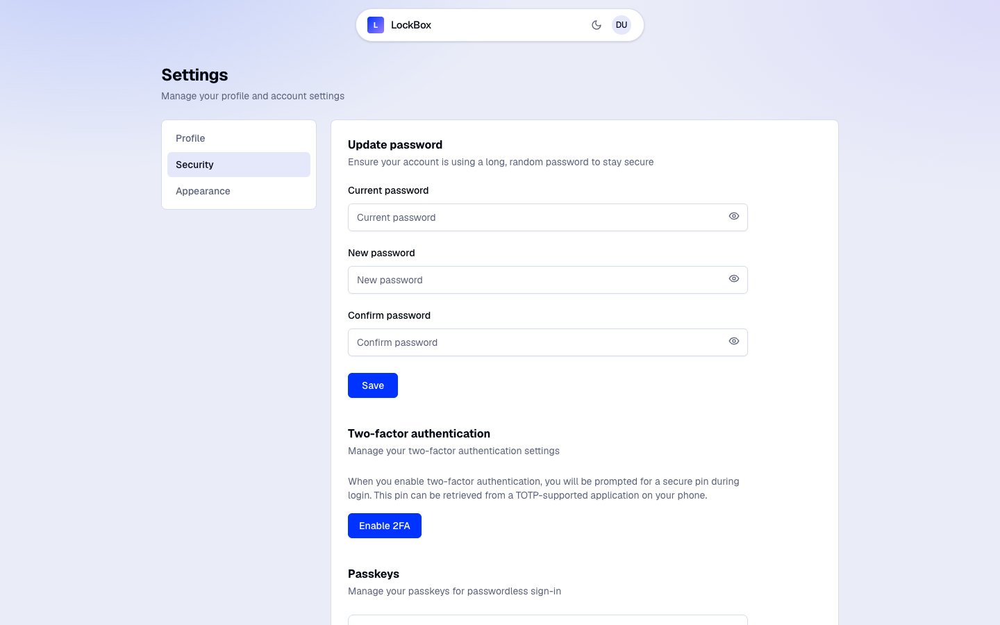

# LockBox

[](https://github.com/badtexter/lock-box/actions/workflows/tests.yml)
[](https://github.com/badtexter/lock-box/actions/workflows/lint.yml)

A self-hosted password manager built to show full-stack craft: an encrypted credential vault,
master-password-gated reveals, 2FA, and passwordless sign-in with passkeys — on a Laravel +
Inertia + React stack.

Originally built as a university cybersecurity course project: the brief required implementing
classical ciphers (Caesar, Playfair) by hand rather than reaching for a library, so the vault's
encryption is a from-scratch, **intentionally non-production** cipher — see
[Security notes](#security-notes) for exactly what that means and why it's not used to protect
anything real.

Not a production password manager — don't store real credentials in it.

## Screenshots

| | |
|---|---|
| **Landing page** | **Log in** (split-screen, passkey support) |
|  |  |
| **Vault — light** | **Vault — dark** |
|  |  |
| **Profile settings** | **Security — password, 2FA, passkeys** |
|  |  |

## Features

- **Encrypted vault** — every credential is encrypted at rest with a custom, hand-rolled cipher
  (hex → Caesar shift → Playfair square) built for a cybersecurity course assignment, never
  stored or logged in plain text. See [Security notes](#security-notes) — this is a teaching
  cipher, not a cryptographically sound one.
- **Master-password-gated reveal** — viewing or copying a stored password re-confirms the
  account's own password before decrypting anything, server-side.
- **Strong password generator** — 20 characters, guaranteed upper/lower/number/symbol mix,
  generated with `crypto.getRandomValues`.
- **Search** — instant client-side filtering by platform or email.
- **Two-factor authentication** — TOTP with QR setup and single-use recovery codes.
- **Passkeys** — WebAuthn-based passwordless sign-in, register/remove multiple passkeys per
  account.
- **Per-user authorization** — every credential is scoped and policy-checked, so one user can
  never view, edit, reveal or delete another's data.
- **Light and dark mode**, responsive down to mobile.

## Tech stack

**Backend** — Laravel 13 · PHP 8.3+ · Laravel Fortify (auth, 2FA) · Laravel Passkeys (WebAuthn)
· SQLite · Pest 4

**Frontend** — Inertia.js v3 · React 19 · TypeScript · Tailwind CSS v4 · shadcn/ui

**Dev environment** — Laravel Sail (Docker)

## Getting started

Requires Docker (for Sail), PHP 8.3+ and Node 20+ on the host for the initial install step.

```bash
composer install
cp .env.example .env
php artisan key:generate

# Laravel Sail (Docker)
php artisan sail:install --with=mailpit
./vendor/bin/sail up -d
./vendor/bin/sail artisan migrate

npm install
npm run build   # or `npm run dev` for hot reload
```

The app is then available at `http://localhost`.

## Testing

```bash
./vendor/bin/sail artisan test --compact
```

Feature tests cover the vault's CRUD and authorization (a user can never touch another user's
credentials), the master-password reveal flow (correct/incorrect password, legacy-cipher
accounts), authentication, 2FA and profile/security settings.

## Security notes

- **The vault cipher is a classroom exercise, not real cryptography.** It's a composition of a
  Caesar shift and a Playfair square (see
  [`app/Services/PasswordCipher.php`](app/Services/PasswordCipher.php)) — both are centuries-old
  pencil-and-paper ciphers with a tiny key space and well-known plaintext-recovery attacks. They
  were a deliberate choice for a cybersecurity course assignment that asked for classical ciphers
  implemented from scratch, not an attempt at production-grade encryption. **Do not store real
  passwords in this app.** A real implementation would use an audited primitive such as
  AES-256-GCM via Laravel's own `Crypt` facade — see
  [Future improvements](#future-improvements).
- The vault's "master password" is the user's own account password, checked server-side on every
  reveal.
- Account passwords (the ones protecting the vault itself) require 14+ characters with mixed
  case, numbers and symbols, and are checked against known-breached passwords on signup.

## Future improvements

- Replace the classroom cipher with real, audited encryption (AES-256-GCM via Laravel's `Crypt`
  facade) and migrate existing records
- Password breach monitoring (Have I Been Pwned range API)
- Secure password sharing between users
- Browser extension for autofill

## License

[MIT](LICENSE)
